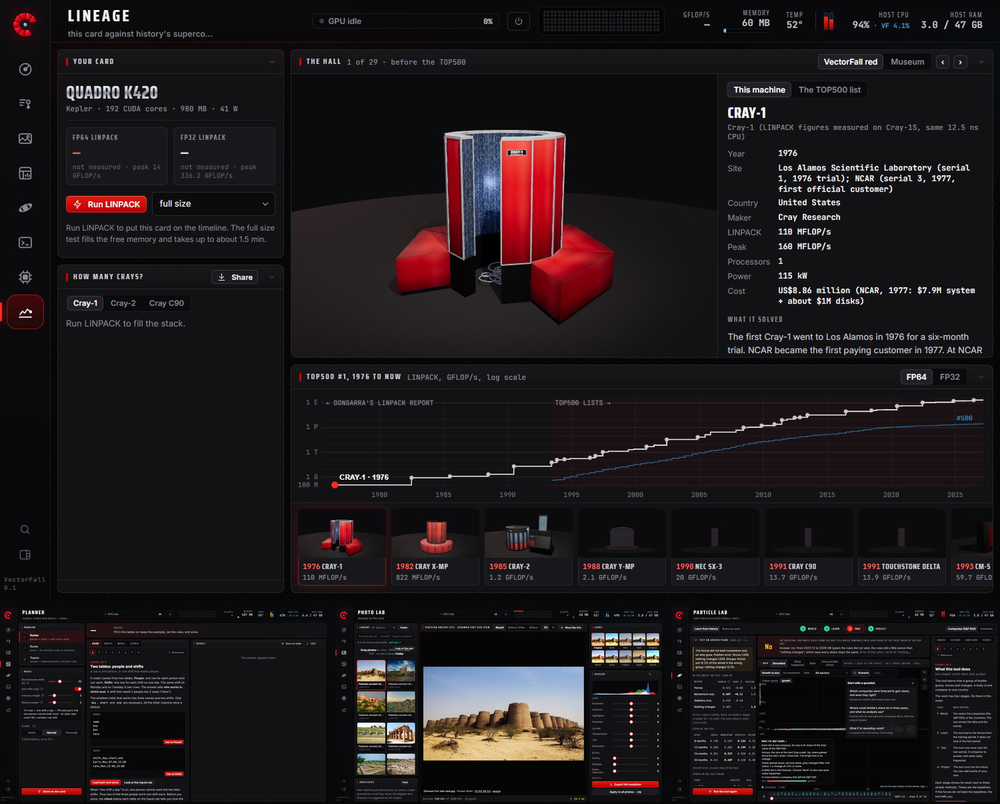

# VectorFall

[](LICENSE)
[](https://github.com/ahtx/vectorfall/releases)



VectorFall is personal supercomputing. It is a GPU algorithms lab for you and for your AI agents. You bring your
own data: tables, text, audio, images and time series. VectorFall runs serious algorithms on the data with your
NVIDIA card. It scores each result against chance and against simple baselines, so you can see if the result is
real.

VectorFall runs on NVIDIA cards from the 1 GB Quadro K420 (Kepler, 2012) to current cards. One image serves every
card. Every operation is a registered model. You can use each model from the web interface, from the REST API
(`/v1`, OpenAPI 3.1), from JSON-RPC 2.0 (`/v1/rpc`), from MCP (`/mcp`, for AI agents) and from the `vf` command-line
client.

## Install in three commands

On Linux, with Docker or Podman and the NVIDIA driver:

```sh
curl -fsSLO https://raw.githubusercontent.com/ahtx/vectorfall/v0.1.0/install.sh
bash install.sh
vfctl status
```

The installer checks the driver and the GPU access, asks which card to use, gets the image, starts the server and
shows the address. Then open `http://localhost:8092` in a browser. For the options, the Windows steps and the
manual steps, see [docs/INSTALL.md](docs/INSTALL.md).

## What you need

- Linux on an x86-64 computer. On Windows, use Docker Desktop with WSL2 (see [docs/INSTALL.md](docs/INSTALL.md)).
- An NVIDIA card (see the table below) and its driver.
- Docker with the NVIDIA Container Toolkit, or Podman with an NVIDIA CDI spec.
- Python 3.6 or later on the host, for `vfctl`.
- About 3 GB of disk for the image, and space for your data.

## Supported cards

The image has CUDA 10.2 and CuPy 9.6. CUDA 10.2 is the last CUDA toolkit with support for the Quadro K420
and other Kepler cards at compute capability 3.0 or 3.2. CuPy compiles kernels when they are first used.
On newer cards, the driver compiles the PTX code for the card.

| Architecture | Compute capability | Examples | Driver | Status |
| --- | --- | --- | --- | --- |
| Kepler | sm_30 to sm_37 | GTX 600/700, Quadro K420 to K6000, Tesla K40/K80 | 470 (the last driver for Kepler) | Tested: Quadro K420 |
| Maxwell | sm_50 to sm_53 | GTX 750/900, Quadro K1200, M4000 | 580 or earlier (580 is the last branch for Maxwell) | Tested: Quadro K1200 |
| Pascal | sm_60 to sm_62 | GTX 10 series, Quadro P series, Tesla P100 | 580 or earlier | Tested: GTX 1080 |
| Volta | sm_70, sm_72 | Titan V, Tesla V100 | 580 or earlier | Expected to work, not tested yet |
| Turing | sm_75 | RTX 20 series, GTX 16 series, T4 | current | Expected to work, not tested yet |
| Ampere | sm_80 to sm_87 | RTX 30 series, A100, A2000 | current | RTX 3080 tested with the rc3 image (PTX) |
| Ada Lovelace | sm_89 | RTX 40 series, L4 | current | Expected to work (PTX), not tested yet |
| Hopper, Blackwell | sm_90 to sm_120 | H100, RTX 50 series | current | Expected to work (PTX), not tested yet |

Driver notes:

- A Kepler card needs driver 470. This driver also supports the GTX 1080. If a second card needs a driver newer than
  470, put the two cards in different computers.
- The driver must be 440.33 or later (CUDA 10.2).
- VectorFall uses one card. It uses all the memory of that card that it needs. Choose the card with
  `vfctl gpu select`.
- If a display is connected to the card, the driver stops a kernel that runs longer than about 2 seconds.
  VectorFall splits its work into short kernels. A card without a display is better.

## Use it

| What | Where |
| --- | --- |
| Web interface | `http://localhost:8092` |
| HTTPS (the browser allows the microphone and the camera only on HTTPS) | `https://localhost:8493` (self-signed certificate) |
| REST API and OpenAPI document | `http://localhost:8092/v1`, `/v1/openapi.json`, `/v1/docs` |
| JSON-RPC 2.0 and OpenRPC | `POST /v1/rpc`, method `rpc.discover` |
| MCP for AI agents (streamable HTTP) | `http://localhost:8092/mcp` |
| Command-line client | `curl -o vf http://localhost:8092/v1/cli && python3 vf list` |
| Version and health | `http://localhost:8092/api/version` |

To connect an MCP client, give it the URL `http://localhost:8092/mcp`. Each model is a tool. The tool names use `_`
in place of `.`, for example `sim_finance`.

Use `/mcp?tools=plan,problem` to load the tools for planning and problem templates. Use `/mcp?tools=discover` to
start with a short list. The agent can list groups with `vf_groups`, choose tools with `vf_tools` or `vf_find`, load
their input schemas with `vf_describe`, and call a tool with `vf_run`. For keyword search with schemas in the same
response, use `/mcp?tools=find`.

Look after the server with `vfctl` (see [docs/VFCTL.md](docs/VFCTL.md)):

```sh
vfctl status          # container, card, version, address, jobs
vfctl doctor          # checks with PASS, WARN or FAIL and a fix for each problem
vfctl logs -f         # the server log
vfctl backup          # save the data folder
```

## Configuration

The settings are in the `.env` file of the VectorFall folder (default `~/vectorfall/.env`). The installer writes
it. [.env.example](.env.example) lists every key. After you change `.env`, run `vfctl restart`.

| Key | What it is | Default |
| --- | --- | --- |
| `VF_GPU` | The card: a UUID or an index from `nvidia-smi -L` | chosen by the installer |
| `VF_ENGINE` | `docker` or `podman` | the engine that works |
| `VF_IMAGE` | The image | `ghcr.io/ahtx/vectorfall:0.1.0` |
| `VF_BIND` | `127.0.0.1` (this computer only) or `0.0.0.0` (the local network too) | `127.0.0.1` |
| `VF_PORT`, `VF_TLS_PORT` | The HTTP port and the HTTPS port | `8092`, `8493` |
| `VF_DATA` | The data folder | `./data` |
| `VF_TLS_HOSTS` | The names and addresses that the HTTPS certificate covers. Delete `data/run/tls/` to make a new certificate after a change. | `localhost,127.0.0.1` |
| `VF_TRUSTED_NETS` | More networks (CIDR) that can use the Console, in addition to private ranges and loopback | none |
| `VF_URL` | The server address for the `vf` client | `http://localhost:8092` |

The Console runs Python code on the server. Only callers from loopback, private networks and `VF_TRUSTED_NETS` can
use it.

## Build the image

```sh
docker build -t ghcr.io/ahtx/vectorfall:0.1.0 --build-arg VF_VERSION=$(cat VERSION) .
```

The build uses only public sources: Ubuntu 18.04 (pinned by digest) and the CUDA 10.2 installer from NVIDIA (pinned
by sha256). The first build downloads 2.5 GB. `bash install.sh --build` builds the image and installs it.

## Add a model

Each operation is one decorated Python function in `app/models/`. See [MODELS.md](MODELS.md). The web interface,
REST, JSON-RPC, MCP and the `vf` client get the new model automatically. To test every model that does not change
stored data, run `vf test`. To test the API contract against a running server, run
`VF_URL=http://localhost:8092 python3 tests/test_api_contract.py`.

## Acknowledgements

VectorFall stands on the work of many people. Thank you to the authors of NVIDIA CUDA, CuPy, NumPy, SciPy,
FastAPI, Uvicorn, Pydantic, Pillow, pdfminer.six, python-docx, python-pptx, openpyxl, XlsxWriter and three.js.
The sample music is by Kevin MacLeod (incompetech.com), the classic novels come from Project Gutenberg, and the
sample photos come from Wikimedia Commons. See [CREDITS.md](CREDITS.md) and [NOTICE](NOTICE).

## License

Free for non-commercial use ([PolyForm Noncommercial 1.0.0](LICENSE)). Commercial use requires a licence: see
[COMMERCIAL-LICENSE.md](COMMERCIAL-LICENSE.md). Contributions: see [CONTRIBUTING.md](CONTRIBUTING.md) and
[CLA.md](CLA.md). Third-party notices: see [NOTICE](NOTICE).

Copyright (c) 2026 Amir Husain.
